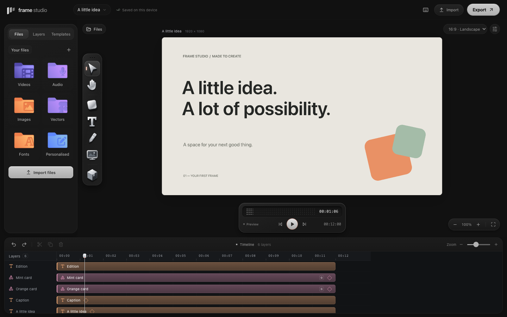

# Frame Studio

A local-first canvas and video editor for Mac. Arrange video, audio, images, text, and vectors on one canvas, then bring them together on a color-coded timeline.

Frame Studio is an early, open-source alpha. The aim is the directness of a design tool with an approachable video-editing workflow: reusable compositions, clear controls, and an interface that feels at home on a Mac.

The workspace separates media from creation tools and keeps visuals above a dedicated audio area. Expand a timeline layer to edit entrances, easing, exit fades, or sound levels and fades. Resize or fit the timeline, choose a canvas preset or custom dimensions, and start from seven editable templates. Playback and seeking sit together in the timeline toolbar.

**Alpha 6 adds 12 editable components**: browser and terminal windows, a phone, notifications, chat, social cards, titles, and callouts. Open **Components → Ready-made**, search or choose a category, then click to insert at the playhead. Edit the group's text under **Design → Content**, or resize its pieces together with W/H. Your saved compositions stay under **Yours**.

The inspector now offers **six color looks with adjustable strength** and **five motion choices**, with detailed controls tucked under Adjust and Fine-tune. Looks and motion apply to selected unlocked visual elements; Pop is available for a single element so it does not pull a component apart. The [Resolve workflow analysis](docs/resolve-workflow-analysis.md) documents the public references, exact implemented behavior, and future functions.

Switch to **3D layers** to inspect the composition's stacking order from the front, back, top, or an orbiting perspective. Select a layer and move it forward or backward to change its actual order in the composition. This is a CSS 3D inspection view of editable 2D layers; camera angle, spacing, and zoom are workspace controls and do not change exported geometry. It does not import 3D models or render a 3D scene into video.



## Run locally

Use **Node.js 22.20+ or 24+** and npm. Node 24 is used in CI.

```sh
npm install
npm run dev
```

Open the local URL printed by Vite. To run the desktop app on a Mac:

```sh
npm run desktop
```

To check and package the app:

```sh
npm test
npm run build
npm run package:mac
```

Packaging currently targets **Apple Silicon Macs (arm64)** and writes DMG and ZIP artifacts to `release/`. These are unsigned development builds unless signing is configured. Public distribution needs the signing and notarization work described in [Distribution](docs/distribution.md). The repository does not automatically publish releases.

## Alpha scope

| Area             | First implementation                                                                                   |
| ---------------- | ------------------------------------------------------------------------------------------------------ |
| Canvas           | Select and arrange layers; text, shapes, freehand drawing, and editable common SVG primitives          |
| Timeline         | Move, trim, and split clips; preview a composition                                                     |
| Media            | Import local video, audio, and images; volume, mute, and audio fade controls                           |
| Organization     | 12 editable components; saved compositions; group text editing and proportional resize; depth ordering |
| Motion and color | Motion recipes, timing and easing; six color looks, strength, and basic adjustments                    |
| Layout           | Common aspect ratios and starter layouts for screen recordings and presenters                          |
| Projects         | Device-local autosave; save and reopen projects with embedded media                                    |
| Export           | PNG/SVG snapshots and real-time video recording using supported runtime formats                        |

Video export uses the runtime's `MediaRecorder` capabilities. **WebM is the primary target; MP4 is only available when supported by the current runtime.** Export runs in real time. This is not yet a deterministic frame-by-frame render engine.

Imports are limited to **50 MB per file**, and project loading is limited to **100 MB total**. Media is embedded as data URLs in project files, so saved projects can grow quickly. SVG editing supports a subset of SVG rather than complete Illustrator compatibility. SVG snapshots require hiding visible video layers; use PNG for a complete frame containing video. Saved components are reusable copies, not linked instances with nested overrides.

Keyframe curve editing, camera moves, transitions between clips, playback-speed changes, professional audio processing, advanced color grading, automatic editing/reframing, and a signed public installer are future work. See the [roadmap](docs/roadmap.md) for the intended sequence and acceptance criteria.

## Built to extend

- **React + TypeScript** for the editor and project model.
- **Canvas 2D** for composition rendering.
- **Electron** for the Mac app and local file dialogs.
- **Vite, Vitest, and Playwright** for development and verification.

Start with the [architecture](docs/architecture.md), [development guide](docs/development.md), and [project format](docs/project-format.md). The [design language](docs/design-language.md) explains the visual system and layer colors.

## Contribute

Frame Studio is designed to improve incrementally. Small, focused changes with a clear user outcome are welcome. Read [CONTRIBUTING.md](CONTRIBUTING.md) before opening a pull request and [SECURITY.md](SECURITY.md) for vulnerability reporting.

Product references are inspiration for interaction and capability. Frame Studio does not include source code or proprietary assets from CapCut, Figma, Adobe, Canva, Apple, Flask, or DaVinci Resolve, and is not affiliated with those products.

Licensed under the [MIT License](LICENSE).
