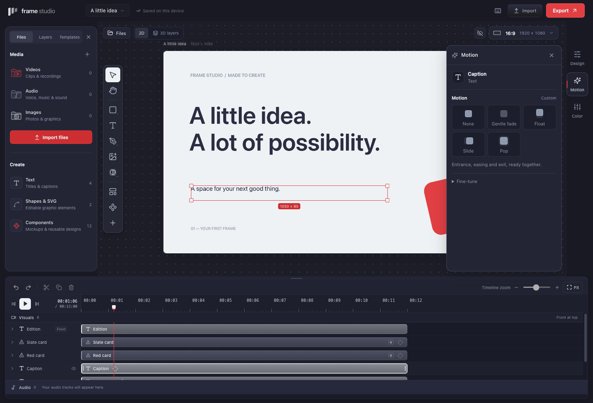
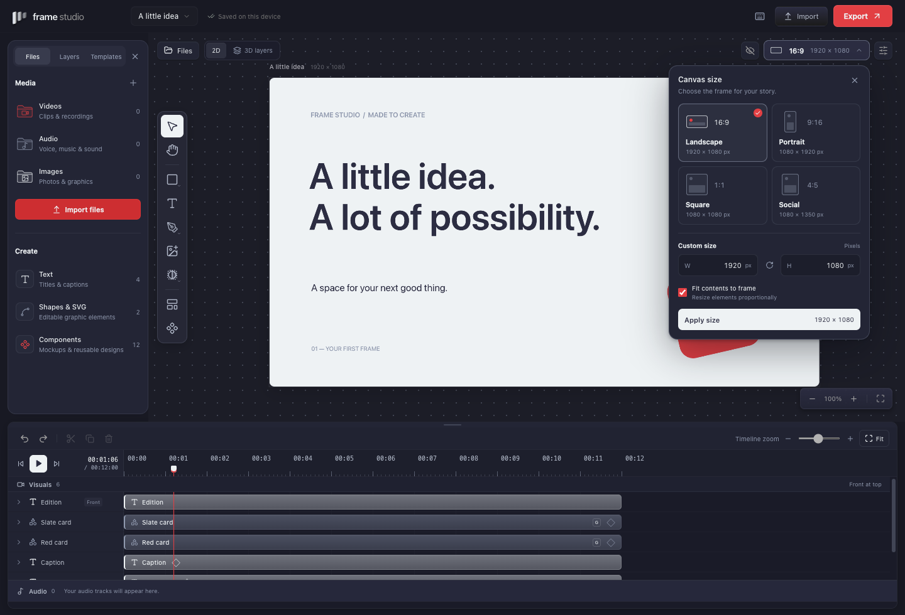
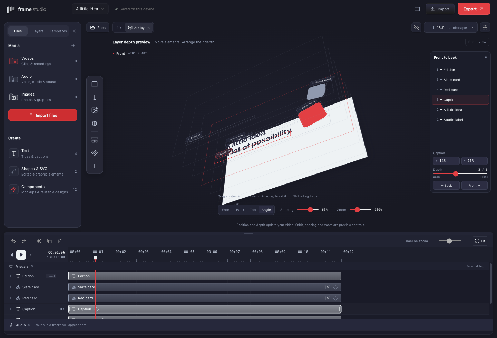
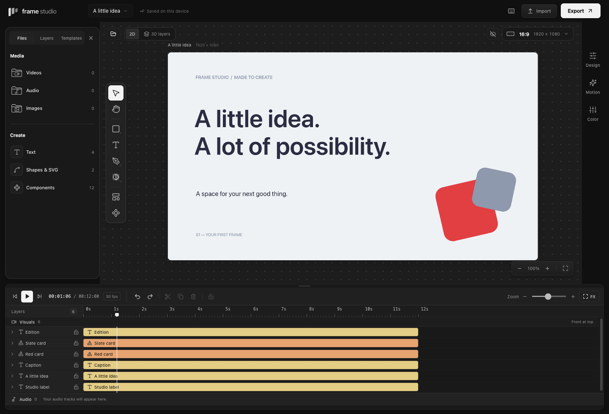

# Design language

Frame Studio keeps the board at the center of a compact editing workspace. The library explains what can be added, the board shows the composition, and the timeline separates visual layers from sound. Black, charcoal, and white keep the interface quiet; timeline clips retain distinct category colors.

## Interface principles

1. **Edit the object directly.** Select, move, and resize on the board. Selection is shared with the library and timeline.
2. **Keep files separate from creation tools.** Video, audio, and image imports are media. Text, vector shapes, and reusable components have a dedicated Create group.
3. **Keep controls close to their effect.** Expand a timeline track to adjust its motion or sound. Use properties for the selected element's other details.
4. **Make previews truthful.** Template thumbnails use the same composition renderer as preview and export. Audio waveforms, analysis, or arbitrary keyframe capabilities must not be implied when unavailable.
5. **Keep changes reversible.** Applying a template, changing frame size, and reordering layers remain undoable. View navigation, depth-view camera controls, and timeline height do not alter project content.

## Palette

The interface palette is:

| Token      | Color     | Use                                            |
| ---------- | --------- | ---------------------------------------------- |
| Background | `#101010` | Workspace and board surround                   |
| Panel      | `#191919` | Library and editing surfaces                   |
| Raised     | `#222222` | Menus and raised controls                      |
| Border     | `#303030` | Quiet divisions and outlines                   |
| Muted      | `#989898` | Secondary text and icons                       |
| Text       | `#F3F3F3` | Primary labels                                 |
| Accent     | `#F1F1F1` | Primary actions and selections, with dark text |

Neutral surfaces and transparent variants provide depth. A fine outline, quiet hover surface, and clear active state are more useful than decorative chrome. Selection outlines combine light and dark edges so they remain visible over different artwork. Every interactive icon keeps a descriptive accessible name. Artwork colors, palette swatches, and look previews represent project content and remain independent of this interface palette.

`LAYER_COLORS` and `LAYER_LABELS` in `src/core/types.ts` define category colors. These identify layers independently of their rendered fill:

| Kind      | Label   | Color     |
| --------- | ------- | --------- |
| `video`   | Video   | `#7FB8F6` |
| `audio`   | Audio   | `#65D5B0` |
| `image`   | Image   | `#D799E6` |
| `text`    | Text    | `#E9CC82` |
| `shape`   | Shape   | `#F0A06D` |
| `svg`     | Vector  | `#B2A2EF` |
| `drawing` | Drawing | `#75CDD7` |

Each category has a stable color, with icons and labels alongside it. Clip text uses charcoal on the light category color. These colors identify the layer type; they do not change the artwork or imported media.

## Library and templates

The library has three tabs: Files, Layers, and Templates. Files opens two concise groups:

- **Media:** Videos, Audio, and Images. Each row shows the current project count and opens its files and import action.
- **Create:** Text, Shapes & SVG, and Components. Text offers heading, subheading, and body presets; Shapes & SVG adds editable graphics; Components saves and reuses selections.

Small monochrome vector icons, concise labels, and counts identify categories. The default library omits repeated descriptions and generic import buttons. The header provides the global Import action; an opened media category offers its specific import action. The canvas tools focus on creating and editing objects, while the library toggle is icon-only when the library is already open. Empty states describe what belongs in each category. The Layers tab separates Visuals and Audio while preserving the relative visual stacking order.

Seven editable templates are provided: Blank canvas, Portrait title, Screen + camera, Speaker lower third, Tutorial chapter, Product spotlight, and Square announcement. Each uses ordinary project layers and its own artwork colors. The template card renders its actual composition, identifies its ratio and duration, and provides a clearly labeled Use template action. Footage and product-image spaces are labeled placeholders, not bundled stock media. Templates replace the current scene; Undo restores it.

## Board and frame size

The board supports direct selection and resizing, hand-tool or Space-drag panning, and pointer-centered zoom. Panning and zooming affect the workspace view, not the exported composition. A slim right rail gives Design, Motion, and Color their own menus. The selected menu opens beside the rail without shifting the board during a drag; clicking it again collapses the panel. The close button and Escape return focus to that menu while keeping the selection.

Design holds layout and content controls, Motion holds animation presets and timing, and Color holds colors, looks, and image adjustments. Without a selection, Design shows project settings, Color edits the canvas background, and Motion explains how to select an element. Audio selections use Sound in place of Motion and disable Color. The rail stays out of the 3D workspace and hides with the other panels in focus mode.

The frame-size picker shows landscape, portrait, square, and social formats as four visual cards with their ratios and exact pixel dimensions. The trigger keeps the current ratio and dimensions visible. Custom width and height have a swap control and can be applied with Enter. Fit contents to frame scales existing objects uniformly; turning it off changes frame dimensions while preserving object coordinates and sizes. Resizing can be undone; choosing the existing size preserves undo and redo history. The menu fits the window and restores focus when closed with Escape.

One timeline toolbar groups playback and exact time, editing and selection locking, then zoom and Fit. The ruler underneath is dedicated to seconds and seeking. Second labels sit above the tick marks, with a small playhead handle below them to avoid covering the time labels. Arrow keys step one frame; Shift + arrow steps one second. The canvas remains available for the composition and its editing tools.

The 3D layers view separates the current frame's visible visual layers into CSS 3D planes. Orbit or pan the view, change layer spacing and zoom, or use front, back, top, and perspective presets to inspect overlap. Audio has no visual plane. Hidden layers and clips outside the current time are omitted. These camera controls affect inspection only. Per-element perspective is an independent saved content edit that renders in the composition and exports.

Selecting a plane or its layer-list row shares selection with the editor. Dragging an unlocked plane moves its actual X/Y position using perspective-correct pointer mapping; selected unlocked visuals move together. Precise X/Y fields also work in edge-on views, where direct plane dragging is unavailable. Empty-space drag or Alt-drag orbits, while Shift-drag or middle-drag pans. Camera navigation stays separate from content edits.

The selected layer's Layer order slider and forward/back buttons change its saved stacking order and the 2D result. Layer order is separate from the 3D element Depth control. Position and order gestures each create one Undo step. Locked selections cannot be moved; audio keeps its own array slots during depth changes. Visible Back/Front endpoints and the numbered layer list make the order clear.

## Timeline, motion, and sound

Visual and audio tracks have separate labeled sections. Visual tracks show the frontmost layer at the top, explained once in the section header. Each layer keeps its own editable clip in a compact 26-pixel row. Solid category colors, concise names, and a clear selection outline keep the clips readable. The ruler displays seconds and adjusts label spacing as the timeline zoom changes; seeking remains frame-snapped. Fit timeline makes the full sequence reachable in the available width. Trim edges are visible on interaction, and image clips use their real imported thumbnails. The timeline height can be changed by dragging its separator or using its arrow-key controls.

Each row has a lock control, and the toolbar can lock or unlock the selection in one undoable action. A mixed selection locks all selected layers; an entirely locked selection unlocks them. Locked clips can be selected but cannot be moved, trimmed, split, or deleted. A subtle hatch and lock icon reinforce the state without relying on color alone.

Expanding a visual track exposes entrance and exit timing. Entrance presets are None, Fade, Rise, Pop, and Slide. Duration, delay, easing, and exit fade are editable through the inline controls and properties. The entrance and exit strips represent those actual timing settings and can be adjusted directly. This is preset-based motion editing, not an arbitrary keyframe graph editor.

Expanding an audio track exposes volume, mute, and fade-in/fade-out duration. Audio-only properties omit visual transforms and opacity. Sound fades affect gain independently of visual opacity. Shared timing calculations keep preview and export consistent; shortening a clip clamps its effective timing without discarding authored values.

## Accessibility and motion

Do not encode category, mute, lock, or selection through color alone. Provide descriptive labels and tooltips, visible focus, keyboard access to controls, and readable contrast. Empty categories remain usable through their import or creation action.

Interface motion respects reduced-motion preferences. That preference governs the interface; it does not alter animation intentionally authored into a video.

## Inspiration and originality

The brief draws on CapCut's approachable editing, Figma's direct object manipulation, and iOS clarity. Reference screenshots inform the spacious board and differentiated tracks. The earlier [Flask](https://flask.do/) study informed compact control surfaces; the monochrome workspace keeps emphasis on the composition and colored timeline. All controls, template compositions, and application code are developed for Frame Studio.

## Element 3D

The Design inspector and depth workspace share one compact 3D element section: an explicit enable switch, three pose shortcuts, X/Y tilt and depth, and Reset. Motion has separate Still, Tilt in, Flip in, and Float choices. The timeline exposes these settings inside the selected row. Only one selected visual element is eligible; group or audio selection shows a short explanation. Locked controls remain visible but disabled.

The projected outline follows playback time and supports ordinary translation. Inspector dimensions remain available for precise resizing. Perspective controls do not change the canvas or orbit the workspace. Repeated controls share the same component and project values; open/closed panel state is transient.
