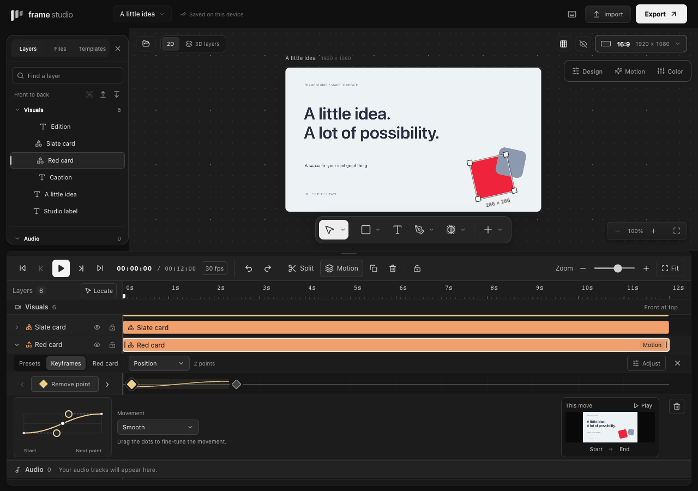

# Keyframes

Select an element, click **Motion** above the timeline, and choose **Keyframes**.

1. Choose an animation property from the dropdown: **Position**, **Size**, **Rotation**, **Opacity**, or an extra property. One lane is visible at a time; the menu shows each property's point count.
2. Click **Add point**, then click later in the lane to move the playhead. **Add next point** can place a second point for you.
3. Give the second point a different pose: move or resize the element on the canvas, or open **Adjust** to change its values. Two identical poses stay still; the editor explains when this is the case.
4. Drag a point left or right to retime it. Select a point to edit its movement curve beside the composition preview.

The editor opens on a property that already has animation, when available, and follows the selected layer. Nearby points separate vertically so one cannot hide another; their horizontal positions still represent time. Exact values and selected-point time stay under **Adjust**.

Position groups X and Y; Size groups width and height. A diamond edits the paired values together. Values are absolute canvas pixels, degrees, or opacity percent. Size scales the actual artwork, including text, masks and strokes. Rotation keeps the numeric angle, so 0 → 360 makes a complete turn.

## Extra properties

Use the animation-property dropdown to choose any supported property. It shows existing point counts, so you can find the animated channels without expanding several rows. Reveal direction and character/word mode live under **Adjust** for the selected property.

| Lane        | Stored channels      | Values                                                |
| ----------- | -------------------- | ----------------------------------------------------- |
| 3D tilt     | `rotateX`, `rotateY` | −180° to 180°, paired X/Y perspective angles          |
| Depth       | `depth`              | −100 farther away to +100 closer                      |
| Soft blur   | `blur`               | 0–80 authored artwork pixels, scaled with the artwork |
| Mask reveal | `reveal`             | 0–100%, from left/right/up/down or the center         |
| Text reveal | `textReveal`         | 0–100%, by character or word; text layers only        |

Together with Position, Size, Rotation and Opacity, these are 12 scalar channels. Reveals preserve the original artwork/text layout and combine with the existing shape mask. Soft blur is a focus effect, not temporal motion blur. 3D tilt and depth change a flat visual plane; layer order still controls stacking.

For a ready-made starting point, open **Motion → Motion library** in the right inspector and choose a recipe, then edit its generated diamonds here. The [motion recipes guide](motion-recipes.md) covers grouped movement, stagger, reveals and three editable motion templates.

## Timing

Single-click the lane to seek without adding a point. Click a point to seek to its pose and show the related curve. Open **Adjust** for its exact time. The arrows beside the lane visit its previous or next keyframe. Double-click empty space in the lane to add a keyframe there. **Remove point** removes the keyframe at the playhead. The trash button removes the selected point. A selected diamond accepts Delete/Backspace without deleting the layer; Left/Right moves it one frame, or ten frames with Shift. Each drag is one undoable action. Dragging onto an occupied frame replaces that property's destination key; Undo restores both.

## Curves

A keyframe's curve controls the movement **from that keyframe to the next**. The compact **Movement** dropdown offers **Steady**, **Smooth**, **Speed up**, **Slow down**, or **Hold**, beside an editable graph. Drag either curve handle to make a custom cubic Bézier curve. The horizontal axis is time, and the vertical axis is progress from the current value to the next. Dragging a handle above/below the endpoint range creates overshoot; every property remains within its valid bounds. Handles also support arrow keys, with Shift for larger steps. Hold keeps the current value until the next keyframe. Selecting the final point edits the incoming segment, so either endpoint of a two-point move can open its curve. The curve remains stored on the earlier point.

The **This move** preview renders the actual composition between the selected point and its next point. It starts at the halfway pose; **Start** and **End** show the endpoint poses (at a clip boundary, End shows the last visible video frame), and **Play** loops that move silently. The white dot on the curve follows the same progress. Preview controls never move the main playhead or alter the project. The final point previews and edits the movement into it. With no point selected, the preview spans the active property's keys (or the clip when no keys exist). Preview is static until explicitly played, including with reduced motion enabled.

These are temporal interpolation curves, not spatial path handles or a speed/value graph with separate tangents per axis. Paired Position, Size and 3D tilt channels use the same chosen curve when edited together. Separate imported channel values remain independently evaluated.

## Editing and saving

- Preview, PNG/video export, SVG snapshots and 3D layer previews evaluate the same tracks. SVG export retains its existing limitation on per-element perspective.
- Inspector and canvas geometry follow the current evaluated pose. Edits auto-key only properties that already have tracks; static properties keep their ordinary behavior.
- Legacy entrance/loop/exit presets can combine with manually authored keys. **Reset** affects only those presets. Applying an alpha18 motion recipe writes keys and clears preset motion on the affected elements. Remove individual diamonds to remove authored keys.
- Moving a clip carries its animation. Trimming retains off-clip keys; splitting preserves the exact curve across both halves. Re-extending a trim can reveal retained keys again.
- Duplicates and saved components retain editable tracks. Composition resizing transforms position/size keys and shared perspective origins along with the artwork.
- Locked layers can be inspected and previewed but not edited. Audio uses its separate sound controls.

There are up to 256 keys per scalar property. Old projects open unchanged. Alpha18 adds the extra channels while preserving old projects. Earlier strict parsers cannot open projects using these new fields. Temporal curves do not provide spatial path editing, per-character transform animators or a full speed/value graph.
