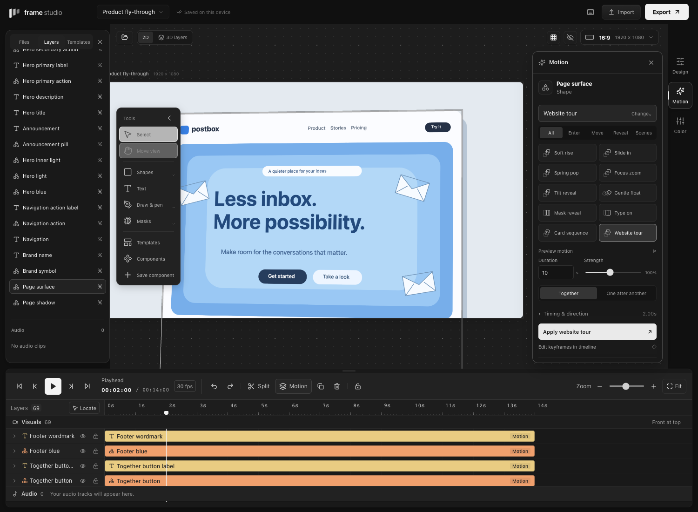

# Motion recipes and scene animation

Select an element or several elements, then open **Motion** on the right.

1. Open **Choose a motion** and select a recipe. Expand **Preview motion** to see it before applying.
2. Set Duration and Strength. Choose Together or One after another.
3. Click Apply. Use **Edit keyframes in timeline** to change individual moments or curves.

The result is ordinary editable keyframes. Saving, reopening, duplicating, saving a component, and exporting retain the animation. Applying a recipe is one undoable action.

## Recipes

| Recipe        | What it creates                                                  |
| ------------- | ---------------------------------------------------------------- |
| Soft rise     | A position move, fade, and focus from soft blur                  |
| Slide in      | A directional entrance for an object or component                |
| Spring pop    | A keyed overshoot and settle around the selection's center       |
| Focus zoom    | A close-up that settles into focus                               |
| Tilt reveal   | A perspective entrance with a shared plane for grouped pieces    |
| Gentle float  | A complete keyed up-and-down cycle                               |
| Mask reveal   | A directional or center wipe through the artwork                 |
| Type on       | A character or word reveal that keeps the original text layout   |
| Card sequence | Sliding cards with configurable stagger and order                |
| Website tour  | A close view of a page, a pan down its contents, and an overview |

Strength changes travel, scale, or tilt. Mask reveal and Type on use Duration to set speed. These are baked movements; Spring pop does not simulate physics, and Soft blur is a Gaussian focus effect rather than temporal motion blur.

**Timing & direction** contains the start time, direction, stagger, reverse order, grouped-part handling, and Hide until entry. Together uses the selection as one unit. One after another keeps existing groups together; enable Animate grouped parts separately to sequence individual pieces. Locked elements and audio do not receive visual recipes. A group with a locked member is kept unchanged.

Recipes replace their affected channels inside the chosen time range and clear preset motion on the animated elements to avoid double animation. Existing animation outside the range is preserved; conflicting boundaries are rejected with an explanation instead of silently changing earlier work. The recipe must fit in every affected clip and the composition. Move the start or shorten the duration if it does not fit.

## Extra keyframe properties

In **Timeline → Motion → Keyframes**, use **+ Add property** to reveal additional lanes:

- **3D tilt:** X/Y perspective angles.
- **Depth:** normalized distance, from −100 farther away to +100 closer.
- **Soft blur:** 0–80 authored artwork pixels, scaled with the artwork.
- **Mask reveal:** 0–100%, from an edge or the center, combined with the existing shape mask.
- **Text reveal:** 0–100% by character or word. Text keeps its layout while revealing.

Properties with keys appear automatically. **Animated only** hides unused rows. The existing diamond, timing, curve, keyboard, and undo controls work on these properties too. Editing a tracked 3D slider changes only that axis's key at the current frame.

Grouped perspective recipes store a common origin and perspective distance. The pieces remain editable layers and project onto one plane. This is a perspective treatment of flat artwork, not a mesh/model editor, light rig, or hierarchical 3D scene.

## Learn from editable examples

Open **Templates**:

- **Product fly-through:** an original editable website with a tilted walkthrough and pull-back.
- **Card choreography:** grouped cards with staggered overshoot.
- **Words in motion:** animated type and an underline reveal.

Hover or focus a template preview to play it. Automatic preview motion respects reduced-motion preferences; the preview can also be played manually. Applying a template replaces the current scene; Undo restores it.

## Reference study

The user-supplied [Pinterest animation](https://www.pinterest.com/pin/333759022406823529/) was inspected at approximately 1.6, 4.0, 6.6, 9.3, and 12.4 seconds. The visible sequence moves along a tilted website, pulls back to reveal a tall page, and returns to a frontal hero view. Soft focus and separate decorative graphics contribute to the depth effect. The camera/blur interpretation is an inference from the rendered frames, not access to the author's project or implementation.

Frame Studio's examples use original text, shapes, and layouts. No reference media or proprietary editing code is included. This release supplies the perspective, pan/zoom, staged entrances, reveal, and focus building blocks for this style. Spatial path editing, per-character transform animators, temporal motion blur, mesh lighting, and a full After Effects graph editor remain separate capabilities.
