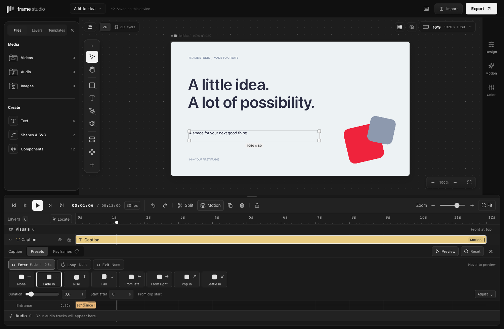

# Timeline and motion controls

The timeline groups playback, editing, and zoom. Controls and clip rows use larger targets and readable labels; category colors stay consistent with the rest of the editor. Click the current time to enter seconds, minutes:seconds, or minutes:seconds:frames. Enter applies a valid time; Escape cancels. Frame-step buttons move by one project frame and pause playback. Locate brings the current playhead into view; Fit shows the sequence.

Select one layer and click **Motion** in the toolbar, or expand its row. The expanded editor has **Preview**, **Reset**, and **Close**. Preview plays the composition over that clip's time span and stops at its last frame. It changes the view only. Reset presets removes preset motion in one undoable edit while retaining the element's position and 3D pose. Locked layers remain readable but cannot be changed.

Choose **Keyframes** for editable property tracks and curves; see the [keyframe guide](keyframes.md). **Presets** shows one phase at a time: **Enter**, **Loop**, or **Exit**. Each phase button also summarizes its current style and duration. Both systems can be combined.

## Pick, preview, adjust

1. Choose **Enter**, **Loop**, or **Exit**.
2. Hover or keyboard-focus a visual tile to preview it; click to apply. Only one tile animates at a time, and reduced-motion preferences use still previews.
3. Drag **Duration** (or **Period**) or enter an exact value. Enter also has **Start after**.
4. Open **Adjust** only when you need movement distance, easing, loop amount, or 3D motion.

The matching timing strip appears beneath the picker; the other phases remain summarized above. Close the editor to return to the compact clip rows and restore the canvas space. Switching back from Keyframes also returns to the compact preset height. If you manually resize the timeline, your chosen height is retained.

## Three phases

- **Enter:** Fade, Rise, Fall, Pop, Slide from either side, or Settle in. Start after and Duration are clip-relative seconds. Travel changes movement distance. Feel provides Steady, Gentle start, Gentle stop, and Smooth both, with a curve showing the actual easing function.
- **Loop:** None, Float, or Pulse. It begins after the entrance finishes and repeats until the clip ends. Period is the duration of a cycle; Amount is pixels for Float and a scale percentage for Pulse. Float starts at its resting position; Pulse grows and returns. This is an authored animation, separate from playback looping.
- **Exit:** None, Fade, Reverse entrance, directional travel, or Shrink. It has its own duration and easing. Travel is shared with entrance travel. Reverse entrance returns toward the selected entrance's initial pose. Missing exit settings retain the earlier fade behavior.

The active phase's timeline strip shows entrance or exit timing and can be moved or resized. The loop strip marks its active interval. They are preset envelopes, not arbitrary property keyframes. Timing remains saved when a clip is shortened; effective values clamp to its current length.

The 3D motion choice applies only to the selected element. Its entrance duration/delay use the same controls as 2D entrances; 3D Float uses that duration as its period. A 2D loop can be combined with the 3D pose. Audio rows have a separate Sound editor with volume, fades, and mute.

All effects use the same motion calculation in preview, hit testing, PNG/video rendering, and supported SVG output. SVG still cannot represent enabled per-element 3D; use PNG or video in that case.

## After Effects workflow study

This is an interaction study of publicly documented behavior. No proprietary implementation or assets are used.

| Adobe workflow                                                                                                                                                                                             | Frame Studio adaptation                                                         |
| ---------------------------------------------------------------------------------------------------------------------------------------------------------------------------------------------------------- | ------------------------------------------------------------------------------- |
| [Previewing](https://helpx.adobe.com/after-effects/desktop/view-and-preview/preview-video-and-audio/previewing.html) documents frame navigation, current time, and preview ranges.                         | Clearly grouped playback, direct time entry, frame steps, and Preview clip.     |
| [Animation basics](https://helpx.adobe.com/after-effects/desktop/animate-in-after-effects/animation-basics/animation-basics.html) separates layer duration from expandable animation properties.           | Readable colored clip rows with an explicit Motion action and closable details. |
| [Speed between keyframes](https://helpx.adobe.com/after-effects/desktop/animate-in-after-effects/speed-between-keyframes/speed.html) describes easing and acceleration.                                    | Four named easing choices with previews of the actual curves.                   |
| [Keyframe operations](https://helpx.adobe.com/after-effects/desktop/animate-in-after-effects/animation-keyframes/setting-selecting-deleting-keyframes.html) include reversing animation.                   | Reverse entrance is an approachable exit preset.                                |
| [Expression reference](https://helpx.adobe.com/after-effects/desktop/work-with-expressions/expression-language-reference/expression-language-reference.html) distinguishes animation cycles from playback. | Simple Float/Pulse loops have explicit period and amount settings.              |

Position, size, rotation and opacity now have real keyframes with temporal Bézier curves. Speed graphs, expressions, motion blur, tracking, and animated mask paths remain separate future capabilities. The current controls do not claim After Effects parity.

## CapCut workflow study

The compact picker adapts interaction patterns documented in CapCut's official guides: [phase categories](https://www.capcut.com/resource/text-animation-in-daVinci-resolve), [visual animation choices](https://www.capcut.com/resource/how-to-add-voice-in-a-video), [duration after choosing a preset](https://www.capcut.com/resource/fade-in-text-in-after-effects), and [property keyframes](https://www.capcut.com/resource/how-to-add-keyframes-in-capcut). The phase summaries, on-demand previews, and Adjust disclosure are Frame Studio design decisions. This is a study of public documentation, not an audit of an installed CapCut build.
