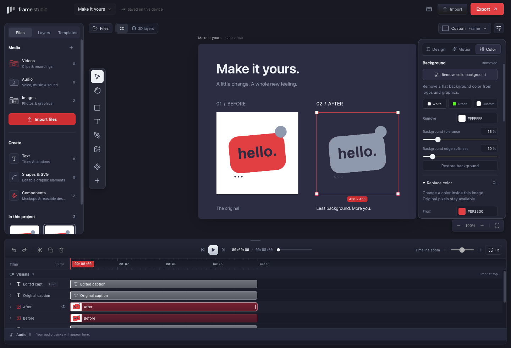
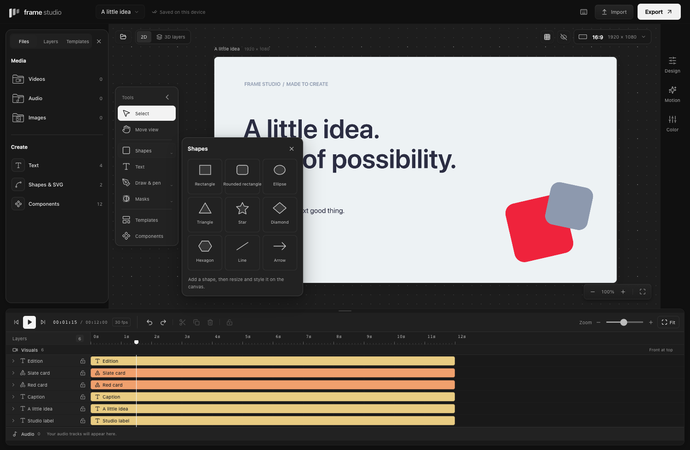
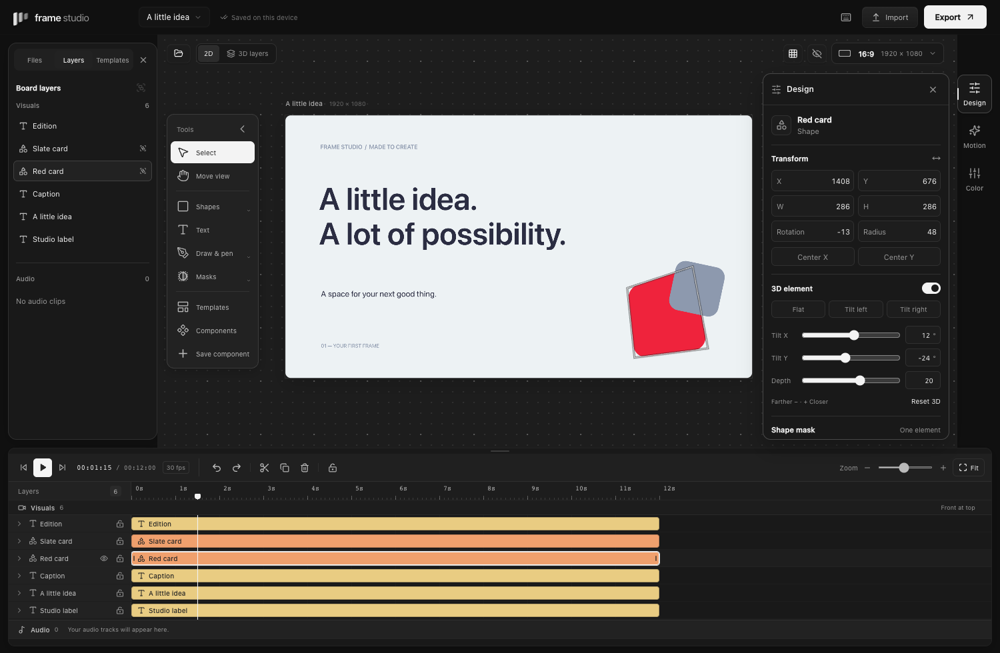

# Visual editing tools

These tools edit the selected layer and participate in Undo/Redo. They run locally and keep the original imported image intact.

## Shapes and drawing

The left **Tools** rail starts with visible names. Use **Collapse tools** for an icon-only rail, or **Show tool labels** to expand it again. **Templates** opens the template library; **Components** opens reusable designs.

**Shapes** opens nine choices: rectangle, rounded rectangle, ellipse, triangle, star, diamond, hexagon, line, and arrow. Each inserts an editable layer at the current playhead. Resize and recolor it on the board or in Properties. Arrow keys move between choices; Enter inserts the focused shape.

**Drawing tools** contains Pencil, Brush, and Pen, with stroke color and width settings and a live stroke preview. Pencil and Brush create freehand vector strokes; Brush starts with a wider stroke. **Pen (B)** builds a path point by point: click for a corner, drag for a smooth Bézier handle. **Enter / Finish** completes an open path. Click the first point or use **Close path** to make a filled closed shape. **Backspace** removes the last draft point; **Escape / Cancel** discards the draft. Completing the path is one undo step.

Paths stay vector data in project files and SVG exports. They can be moved, resized, colored, grouped, masked, and animated like other layers. This creates new paths; reopening imported paths for anchor-by-anchor editing is not yet supported.

Tool menus close with their X, Escape, or a click or keyboard focus elsewhere. The library has its own close button. **Hide panels** clears both side panels and collapses the tool labels; **Show panels** restores their previous state. Tools can still be expanded independently. The board has a two-level dot grid that follows pan and zoom; **Canvas grid** toggles it. These view changes do not alter the project or exports.

## Mask and flip

Select one unlocked visual element, then open **Masks** in the canvas toolbar, or **Design** in Properties. Choose None, Rectangle, Rounded, Ellipse, or Diamond. Without an eligible selection, the menu still shows the four mask shapes and explains how to select an element. **Color & background** opens the selected element’s Color menu; from the 3D workspace it returns to the 2D canvas. Inset brings the mask inward equally from each edge; Roundness adjusts the Rounded mask. These are local bounds, so the mask follows the element when it moves, rotates, or animates. Horizontal and vertical flips use its center and leave its placement and clip timing unchanged.

An ellipse fills the element's bounds; use equal width and height for a circle. An explicit mask replaces the legacy rounded corners of an image or video. None removes clipping. The original geometry stays editable, and changing the mask does not crop pixels out of the source file.

Masks and flips apply to individual visual layers. Ungroup a component to work on one piece. Whole-group masks, arbitrary drawn masks, track mattes, feathered masks, and animated mask paths are not implemented.

## Change a color

Text and shape colors use Fill; drawings use Stroke. Quick swatches use the Frame Studio palette. Mixed selections apply the corresponding fill or stroke to each editable element.

For an image, open **Color → Replace color**. Set From and To colors, then refine Tolerance and Strength. A six-digit hex field lets you enter an exact color. The operation changes matching source colors throughout the image. It does not identify an object or select a spatial region. Existing alpha is retained.

Color replacement is separate from the six looks. Looks still adjust brightness, contrast, and saturation after image cleanup. Restoring the replacement leaves those grading values unchanged.

## Remove a solid background

Select a still image and open **Color → Background**. **Remove solid background** estimates the dominant opaque color along the image border. White, green, and a custom color provide explicit alternatives. Tolerance includes nearby shades; Edge softness blends the boundary between removed and retained colors. Restore background removes the key settings immediately.

This works best for logos, product cutouts, screenshots, and graphics against a plain background. It removes the selected color wherever it occurs, including inside the foreground. It is not AI subject segmentation or a hair-detail tool for complex scenes. Already-transparent borders may not provide a color to estimate; choose a color explicitly in that case.

Background removal and image color replacement currently support still images. Video can use masks, flips, and the existing color adjustments, but does not use these pixel-cleanup effects.

## Give one element a 3D pose or animation

Select exactly one visual layer and open **Design → 3D element**. Enable the switch, pick a tilt pose or adjust **Tilt X**, **Tilt Y**, and **Depth**. Positive depth brings that element closer; negative moves it farther. Existing Rotation controls its in-plane rotation. **Reset 3D** removes the pose and 3D motion; switching off keeps settings for reuse. Locked layers cannot be changed.

Choose **Motion → 3D motion** for **Tilt in**, **Flip in**, or looping **Float**. Fine-tune duration (Float period), delay, and entrance easing, or expand the layer's timeline motion row. The same pose and compact motion controls are available beside the layer stack in **3D layers**. Select an individual piece via the Layers panel when editing a grouped mockup.

You can drag a tilted element by its projected outline. Use Design W/H for resizing perspective artwork; corner handles are hidden for a selection containing 3D. Only that element gains perspective; other elements, canvas dimensions, and the inspection camera stay as authored. Its transform saves with the project and components, and renders in PNG/video. These are flat visual planes, not imported 3D models or lighting effects. Very large perspective artwork uses bounded rasterization and may soften.

## Arrange layers in 3D

Open **3D layers** and drag an element to change its X/Y position. Multiple selected unlocked elements move together; use Command/Ctrl-click on layer rows to change the selection. The X/Y fields offer precise placement, including in the edge-on Top view. Use **Layer order** for a single selected layer, or the forward/back buttons for a selection, to change which elements sit in front. A movement gesture takes one Undo step.

Drag empty space or Alt-drag to orbit. Shift-drag or middle-drag pans, and scrolling zooms. Camera angle, spacing, and zoom only change your workspace view. Position and layer order affect the saved project, 2D canvas, and exports; Layer order controls stacking; per-element Depth controls perspective independently.

## Preview, save, and export

The 2D canvas, 3D layer inspection, PNG, and video output use the same processed image. SVG embeds that processed image while keeping other vector content editable. SVG still requires hiding active video and enabled 3D layers; PNG/video retain their appearance. The composition background remains visible through removed pixels; removing an image's background does not make the composition itself transparent.

Cleanup raster processing is capped at a 4,096-pixel longest side and 8 megapixels. Smaller sources retain their dimensions. The original embedded image is unchanged, so removing the cleanup restores the original resolution. Processing caches are bounded and are not written into project JSON.

New effects are optional fields in version-one project files. Older projects open without migration. Projects using the new fields require alpha 7 or later.
